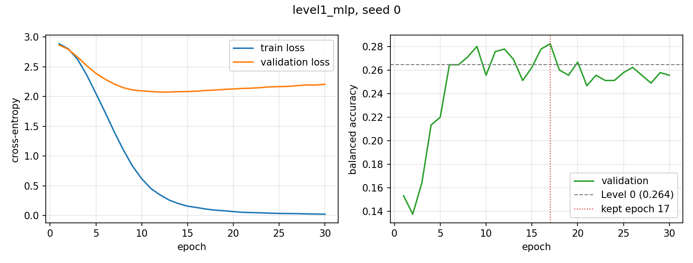

# Name That LLM: Which Model Wrote This Passage?

**Author:** Colton Francis · CSCI 490-B9 Deep Learning, NIU, Fall 2026

**AI tool use:** Claude (claude.ai) helped draft this README and write the scripts. I chose the task, split, models and Level 3 question, and ran the scripts myself. *Progress report:* Claude Code wrote `level1_name_that_llm.py` (MLP and BiLSTM), `bootstrap.py`, `summarize_results.py`, `plot_curves.py` and `run_on_colab.ipynb`, and drafted section 7. I ran every experiment on Colab and checked the numbers in this README against the files in `results/`.

## 1. Task

Input: a 40–250 word passage written by an LLM. Output: which of 18 models wrote it (from OpenAI, Google, Anthropic, Qwen, ZAI and Moonshot AI).

**Example** (prompt `p090`): *Beneath a ferocious sky warped by monstrous gravity, the neutron star’s crust endures unimaginable torment. Here, atomic lattices violently collapse, fusing electrons and protons into an incomprehensibly dense nuclear fluid where a thimbleful outweighs mountains. Spacetime bends savagely backward, warping escaping light into grotesque halos, while the crushing pressure arrests time itself in a silent, suffocating cosmic anvil.*
**Label:** `gemini-3.8-flash`

## 2. Motivation

Knowing which model wrote a text helps check whether a service runs the model it claims and trace where generated content came from. It is hard because the passages are short, all models answer the same prompts, and models from the same lab sound alike. Guessing gives only 5.6%.

## 3. Data

**Source:** [Name That LLM](https://www.kaggle.com/competitions/name-that-llm) on Kaggle, `train.csv` only (the test labels are hidden): 2,699 passages, 150 prompts, 150 passages per model (149 for `claude-fable-5`). License: CC BY-SA 4.0. The data is not committed.

**Split:** by `prompt_id` with a fixed seed (`nll_data.py`): 100 / 25 / 25 prompts = 1,799 / 450 / 450 passages. All answers to a prompt stay in one split, so the model is always tested on new prompts. I choose on validation and use test once.

| Model | Lab | Train | Validation | Test |
|---|---|---:|---:|---:|
| claude-fable-5 | Anthropic | 99 | 25 | 25 |
| claude-opus-4-6 | Anthropic | 100 | 25 | 25 |
| claude-opus-4-8 | Anthropic | 100 | 25 | 25 |
| claude-opus-5 | Anthropic | 100 | 25 | 25 |
| claude-sonnet-5 | Anthropic | 100 | 25 | 25 |
| gemini-3.1-pro-preview | Google | 100 | 25 | 25 |
| gemini-3.6-flash | Google | 100 | 25 | 25 |
| gemini-3.7-flash | Google | 100 | 25 | 25 |
| gemini-3.8-flash | Google | 100 | 25 | 25 |
| kimi-k3 | Moonshot AI | 100 | 25 | 25 |
| gpt-5.5 | OpenAI | 100 | 25 | 25 |
| gpt-5.6-luna | OpenAI | 100 | 25 | 25 |
| gpt-5.6-sol | OpenAI | 100 | 25 | 25 |
| gpt-5.6-terra | OpenAI | 100 | 25 | 25 |
| gpt-6-astra | OpenAI | 100 | 25 | 25 |
| qwen3.8-max | Qwen | 100 | 25 | 25 |
| glm-5.3 | ZAI | 100 | 25 | 25 |
| glm-5.3-flash | ZAI | 100 | 25 | 25 |
| **Total** | | 1,799 | 450 | 450 |

Samples: [samples.md](samples.md). **What I noticed:** every passage is one paragraph with no formatting, so formatting can't give a model away. Punctuation can: Claude and GLM use em dashes (—) in most passages, Gemini and Qwen almost never.

## 4. Method

**Level 0** (from `results/level0_name_that_llm_*.json`):

| Model | Validation balanced accuracy | Test balanced accuracy |
|---|---:|---:|
| TF-IDF character n-grams + logistic regression | 0.264 | 0.298 |

It names the right lab 64.2% of the time on validation, but the right model only 26.4%: telling models from the same lab apart is the hard part.

**Plan:**

| Level | Model | Expected validation balanced accuracy |
|---|---|---:|
| 1 | MLP on TF-IDF features, compared with a BiLSTM | 0.30 |
| 2 | Fine-tuned DistilRoBERTa | 0.38 |
| 3 | Level 3 question, below | – |

**Level 3 question:** Can models from the same lab be told apart, and what gives them away: punctuation, word choice or word order? I will compare model-level and lab-level accuracy, check whether errors stay within a lab, and measure how much accuracy drops when I remove punctuation or shuffle word order. I run each ablation two ways: (a) **test time only**, where the trained model sees altered validation/test passages, to show what it relies on; and (b) **retrained**, where train, validation and test are all altered and the model is retrained, to show how much signal is left without that cue.

## 5. Evaluation

Main metric: **balanced accuracy**, because every model should count equally and it is the competition's metric. I also report accuracy, macro-F1 and the confusion matrix. Choices are made on validation; test is used once. The test set is small (25 prompts), so I run 3 seeds and report a 95% bootstrap interval for balanced accuracy that resamples prompts (1,000 resamples, `bootstrap.py`). Success means clearly beating Level 0 and answering the Level 3 question with evidence.

## 6. Plan

| Week | What I will do |
|---|---|
| 11/2 – 11/8 | Split, data check, Level 0, proposal |
| 11/9 – 11/15 | Level 1: MLP and BiLSTM |
| 11/16 – 11/22 | Finish Level 1 with 3 seeds (progress report 11/19) |
| 11/23 – 11/29 | Level 2: fine-tune DistilRoBERTa |
| 11/30 – 12/3 | Level 3 tests; presentation (Level 2) |

## 7. Progress report

### Results

Balanced accuracy; Level 1 is the mean ± standard deviation over seeds 0, 1, 2. Every number comes from the files listed (`python summarize_results.py level1_mlp level1_bilstm` prints them).

| Level | Model | Validation | Test | Results files |
|---|---|---:|---:|---|
| 0 | TF-IDF char n-grams + logistic regression | 0.264 | 0.298 | `level0_name_that_llm_{val,test}.json` |
| 1 | **MLP on TF-IDF char n-grams** | **0.270 ± 0.003** | **0.296 ± 0.008** | `level1_mlp_seed{0,1,2}_{val,test}.json` |
| 1 | BiLSTM on word + punctuation tokens | 0.199 ± 0.013 | 0.182 ± 0.021 | `level1_bilstm_seed{0,1,2}_{val,test}.json` |

| Level | Model | Lab accuracy (val / test) | Macro-F1 (val / test) |
|---|---|---:|---:|
| 0 | TF-IDF + logistic regression | 0.642 / 0.633 | 0.260 / 0.288 |
| 1 | MLP | 0.651 / 0.647 | 0.262 / 0.285 |
| 1 | BiLSTM | 0.565 / 0.565 | 0.162 / 0.148 |

The 95% bootstrap interval over prompts is about ±0.03 for a single seed (for example MLP seed 0: validation 0.267 [0.247, 0.287], test 0.293 [0.267, 0.322]), so Level 0 and the MLP are within noise of each other.

### (a) What I built

Two neural models, both trained from scratch with `level1_name_that_llm.py` (AdamW, learning rate 1e-3, weight decay 0.01, batch 64, cross-entropy, up to 30 epochs):

- **MLP:** the same character 2–5-gram TF-IDF features as Level 0 (top 50,000 features, fit on train only) → dropout 0.2 → linear 256 → ReLU → dropout 0.5 → linear 18. About 12.8 M parameters, almost all in the first layer.
- **BiLSTM:** lowercased word and punctuation tokens (punctuation such as "—" is kept as its own token; words seen once are mapped to UNK; at most 300 tokens) → 100-d embeddings learned from scratch → bidirectional LSTM with 128 units per direction → max-pool over tokens → dropout 0.5 → linear 18. About 240 k parameters plus 100 per vocabulary word for the embeddings.

**Chosen on validation:** the epoch. After each epoch I compute validation balanced accuracy and keep the best epoch (MLP: epochs 12, 9, 7 for seeds 0, 1, 2; BiLSTM: 28, 28, 13). The other settings are the script defaults; I did not run a grid over them before the test run, and I did not tune after it, because the test set may be used only once per final setting.

### (b) How it compares

- **Against Level 0:** the MLP ties Level 0 (0.270 vs 0.264 on validation, 0.296 vs 0.298 on test); the difference is far inside the ±0.03 bootstrap interval. The BiLSTM is clearly worse (0.199 / 0.182).
- **Against the proposal:** I expected 0.30 on validation for Level 1. The MLP is 3 points short; the BiLSTM is 10 points short.
- **Past the average:** the lab is easy and the model inside the lab is hard. The MLP names the right lab 65% of the time but the right model only 27%. In the Level 0 confusion matrix, about half of all errors (51% on validation) stay inside the right lab, and the most frequent confusions are siblings: `gemini-3.8-flash` → `gemini-3.7-flash`, `gpt-5.6-terra` → `gpt-5.6-luna`, `gpt-6-astra` → `gpt-5.6-luna`. Recall ranges from 0.08 (`claude-fable-5`) to 0.48 (`claude-opus-5`).
- **Level 1 MLP per model:** TODO — fill in from `python summarize_results.py level1_mlp` (recall per model, share of errors inside the lab).



The figure shows training and validation loss (left) and validation balanced accuracy (right) per epoch for the MLP, seed 0. Validation balanced accuracy reaches about 0.25 by epoch 6, peaks at epoch 12 (0.267, the kept epoch) and then drifts down to about 0.25 while training continues: more epochs do not help, so keeping the best validation epoch matters.

### (c) What works, what does not

- **Character n-grams carry the signal.** Putting a hidden layer on top of them (MLP) does not add anything over logistic regression: with 1,799 passages and 50,000 features, the extra capacity mostly memorizes. The limit is the features and the data, not the classifier.
- **Learning words from scratch does not work with 100 passages per model.** The BiLSTM must learn embeddings for every word from 1,799 passages. For two of three seeds its best epoch was 28 of 30, so it may be undertrained, and it is unstable across seeds (lab accuracy 0.49 for seed 1, about 0.60 for the others). It also lowercases text, which throws away capitalization.
- **What I tried that did not help:** a hidden layer over TF-IDF (MLP, no gain) and a sequence model over words (BiLSTM, worse).

### (d) What I will change

- **Level 2:** a pretrained model, which already knows English and only has to learn the style differences — the thing the BiLSTM could not learn from 1,799 passages. Main model: **Qwen3-0.6B-Base fine-tuned with LoRA** (base frozen in fp16, adapters and classification head trained), with **DistilRoBERTa** (`level2_name_that_llm.py`, full fine-tune) as a smaller comparison. Both keep case and punctuation. Same protocol: learning rate and epochs chosen on validation, three seeds, test once.
- **Level 3 question (sharpened by Level 1):** Level 1 shows the lab is easy (≈65%) and the model inside the lab is hard (≈27%). *Which cues separate models inside one lab: punctuation, word choice or word order?* I will (1) measure the share of errors inside the right lab and the hardest sibling pairs, (2) compare a lab-then-model classifier with the flat one, and (3) run three ablations — remove punctuation, shuffle word order, keep only punctuation — both at test time only and retrained, reporting model-level and lab-level balanced accuracy with bootstrap intervals on validation.

## How to run

```
pip install numpy pandas scikit-learn kaggle
kaggle competitions download -c name-that-llm -p data
unzip data/name-that-llm.zip -d data
python data_check.py
python level0_name_that_llm.py
pip install torch matplotlib
python level1_name_that_llm.py --model mlp --seeds 0 1 2 --eval-test
python level1_name_that_llm.py --model bilstm --seeds 0 1 2 --eval-test
python summarize_results.py level1_mlp level1_bilstm
python plot_curves.py level1_mlp 0
```

On Colab (T4 GPU), `run_on_colab.ipynb` runs all of this; each Level 1 run takes a few minutes.

## Data source

Name That LLM, Kaggle: https://www.kaggle.com/competitions/name-that-llm (CC BY-SA 4.0). Not included in this repository.
